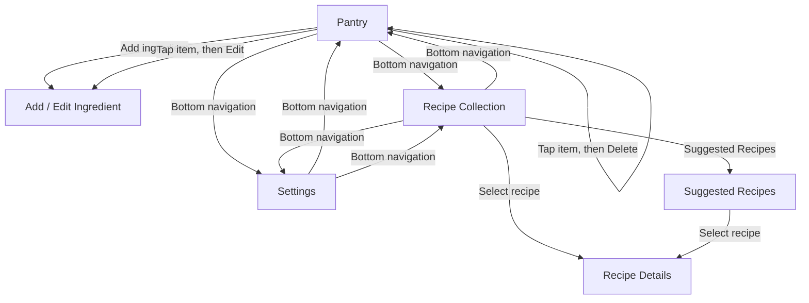
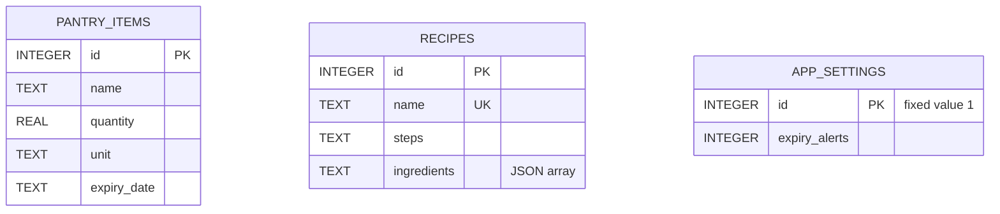

# Smart Pantry Manager — Project Report

> **Current app architecture:** The Android app stores data in local SQLite and runs without a server. The `backend/` directory is an optional standalone Java/PostgreSQL example; the older server-specific examples below describe that separate backend, not a runtime requirement for the app.

## Table of Contents

1. [Introduction](#1-introduction)
2. [System Design](#2-system-design)
   - [Screen Flow](#screen-flow)
   - [Database Model](#database-model)
   - [How the Parts Connect](#how-the-parts-connect)
3. [Key Code Snippets](#3-key-code-snippets)
   - [A. Validate Pantry Details on the Server](#a-validate-pantry-details-on-the-server)
   - [B. Use a Prepared SQL Statement When Adding an Item](#b-use-a-prepared-sql-statement-when-adding-an-item)
   - [C. Run Network Calls Off the Main Thread](#c-run-network-calls-off-the-main-thread)
   - [D. Compare Recipe Quantities Using Compatible Units](#d-compare-recipe-quantities-using-compatible-units)
4. [Challenges and Solutions](#4-challenges-and-solutions)
5. [Conclusion and Reflection](#5-conclusion-and-reflection)
6. [Reference List](#6-reference-list)

---

## 1. Introduction

Smart Pantry Manager is an Android app that helps people keep track of the food and ingredients they have at home. It is aimed at anyone who wants to organise their pantry and find recipe ideas based on what they already have.

Users can add, edit, and remove pantry items. Each item has a name, a quantity, a unit of measurement, and an optional expiry date. The app also shows a list of South African recipes and highlights which ones can be made using the ingredients currently in the pantry. A settings screen lets the user turn expiry alerts on or off.

The Android app is written in Java and stores pantry items, recipes, and settings in SQLite on the device. It works offline. The repository also includes a standalone Java REST API backed by PostgreSQL as an optional multi-device architecture example.

---

## 2. System Design

### Screen Flow

The app has a bottom navigation bar that stays visible across the main screens. The ingredient form opens when the user adds a new ingredient or chooses to edit an existing one. Tapping a recipe opens its detail screen.



### Database Model

The app's SQLite database has three tables. `pantry_items` stores current stock. `recipes` holds the catalogue, including each recipe's required ingredients as a JSON array. `app_settings` stores the expiry-alert preference in a single row. On first launch, the app loads 19 recipes bundled in `app/src/main/assets/recipes.json`.

Because the ingredients are stored as JSON inside the `recipes` table, there is no separate join table or foreign key linking recipes to pantry items.



Key rules enforced by the schema:
- `quantity` in `pantry_items` must be greater than zero.
- `name` in `recipes` must be unique.
- `ingredients` in `recipes` must be a valid JSON array, where each entry has a name, quantity, and unit.
- `app_settings` can only ever have one row because its `id` column is constrained to the value `1`.

### How the Parts Connect

Each screen uses the local data layer in `Api.java`. It performs SQLite reads and writes on a background executor, then posts results to the UI thread. Recipe matching uses the pantry and recipe data stored on the device, so the app needs no host address, network connection, or API process.

---

## 3. Key Code Snippets

### A. Validate Pantry Details on the Server

From `Server.java`:

```java
if (name.isEmpty() || unit.isEmpty() || !Double.isFinite(quantity) || quantity <= 0) {
    throw new IllegalArgumentException(
            "name, positive quantity and unit are required");
}
```

This check runs at the API level, before anything is saved to the database. It rejects requests that are missing a name or unit, or that have an invalid quantity. This matters because requests can come from sources other than the Android form, so the server cannot rely on the app to validate first.

### B. Use a Prepared SQL Statement When Adding an Item

From `Server.java`:

```java
String sql = "INSERT INTO pantry_items(name,quantity,unit,expiry_date) VALUES(?,?,?,?)";
try (PreparedStatement statement = database.prepareStatement(
        sql, Statement.RETURN_GENERATED_KEYS)) {
    bindPantry(statement, ingredient);
    statement.executeUpdate();
}
```

The SQL structure is written separately from the values the user typed. This prevents SQL injection, because the database driver handles escaping. It also makes it straightforward to store a blank optional expiry date as a database `NULL` inside the shared `bindPantry` method.

### C. Run Database Work Off the Main Thread

From `Api.java`:

```java
private static final ExecutorService REQUESTS = Executors.newSingleThreadExecutor();
private static final Handler MAIN_THREAD = new Handler(Looper.getMainLooper());

public static void request(String method, String path, JSONObject body, Done done) {
    REQUESTS.execute(() -> {
        try {
            JSONArray result = execute(database.getWritableDatabase(), method, path, body);
            MAIN_THREAD.post(() -> done.call(result, null));
        } catch (Exception exception) {
            MAIN_THREAD.post(() -> done.call(null, exception.getMessage()));
        }
    });
}
```

Database reads and writes run on a background worker thread. Once an operation completes, its result is posted back to the main thread so the screen can update safely without freezing during disk access.

### D. Compare Recipe Quantities Using Compatible Units

From `Server.java`:

```java
case "kg" -> new Measure(quantity * 1000, "mass");
case "g", "gram", "grams" -> new Measure(quantity, "mass");
case "l", "litre", "liter", "litres", "liters" ->
        new Measure(quantity * 1000, "volume");
case "ml", "millilitre", "milliliter" ->
        new Measure(quantity, "volume");
```

Before comparing amounts, the API converts kilograms to grams and litres to millilitres, then tags each value with a dimension (`mass`, `volume`, `piece`, etc.). This means a recipe that needs 1 kg of flour will match correctly against 1000 g in the pantry, and a mass amount can never accidentally satisfy a volume requirement.

---

## 4. Challenges and Solutions

### Recipe matching needed more than ingredient names

Just because an ingredient name appears in the pantry does not mean a recipe can be made. The user might not have enough of it, or the units might not be compatible. The local data layer checks every required ingredient, adds matching pantry entries, converts supported metric units, and suggests a recipe only if every required amount is available.

### The app should work without a second runtime

The earlier client/server design required a database and API on the development computer. Keeping SQLite inside the app removes that setup and makes it easier to build and demonstrate on machines with limited resources or unreliable development tools.

### Pantry data must be checked consistently

The ingredient form checks required fields, positive quantities, and expiry dates before saving. The local data layer checks them again before writing to SQLite.

---

## 5. Conclusion and Reflection

This project is a self-contained Android app with an on-device SQLite database. It demonstrates persistent storage, input validation, recipe suggestions based on pantry stock, and common metric unit conversions. A standalone Java/PostgreSQL backend example remains in the repository for a possible future multi-device version.

Given more time, I would improve the expiry-alert feature so it actively identifies items nearing their expiry date and notifies the user. I would also add automated tests for recipe matching edge cases, and allow recipe data to be managed through the app rather than only through the database seed file.

---

## 6. Reference List

[1] Smart Pantry Manager, `README.md` — offline features and Android build instructions.

[2] Smart Pantry Manager, `backend/schema.sql` — PostgreSQL table definitions and constraints.

[3] Smart Pantry Manager, `backend/seed.sql` — starter recipe data.

[4] Smart Pantry Manager, `backend/src/main/java/za/co/smartpantry/api/Server.java` — REST endpoints, validation, database access, and recipe matching.

[5] Smart Pantry Manager, `app/src/main/java/za/co/smartpantry/Api.java` — local SQLite access, background database operations, and recipe matching.

[6] Smart Pantry Manager, `app/src/main/java/za/co/smartpantry/BaseActivity.java`, `PantryActivity.java`, `IngredientFormActivity.java`, `RecipeCollectionActivity.java`, `SuggestionsActivity.java`, `RecipeDetailActivity.java`, and `SettingsActivity.java` — screen layout, navigation, and user interactions.
